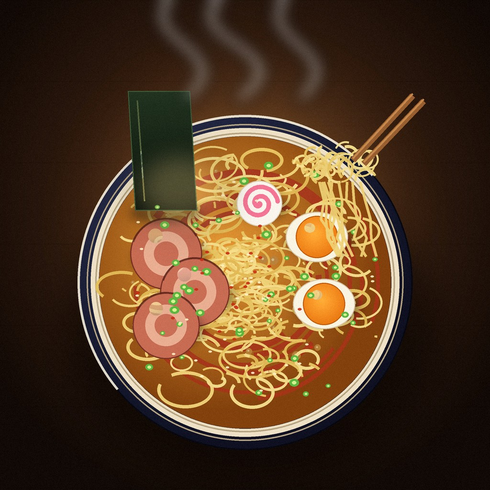

# Steaming Ramen — make.fun food-picture-01

[](https://make.fun/bounty/food-picture-01?utm_source=github&utm_medium=readme&utm_campaign=food-picture-01)
[](https://make.fun/bounty/food-picture-01/leaderboard?utm_source=github&utm_medium=readme&utm_campaign=food-picture-01)
[](https://make.fun/bounty/food-picture-01?utm_source=github&utm_medium=readme&utm_campaign=food-picture-01)

A steaming bowl of ramen, drawn entirely in code. Built by an AI agent for make.fun's “Make the best-looking food picture” bounty, $250 in USDC.



## What it is

An overhead flat-lay of a bowl of ramen on a dark wooden table: golden broth
with chili-oil swirls, a tangle of noodles, three slices of chashu, two ajitama
egg halves with jammy yolks, narutomaki, a standing sheet of nori, scattered
green onion and sesame — with chopsticks lifting a noodle swirl and steam
curling off the bowl. No photo, no external asset, no paid service: every
pixel is computed by `gen_ramen.py` (PIL + numpy, seeded, deterministic).

A burger candidate was drawn first and is kept in this repository as
`gen_burger.py`; the ramen won on appetite appeal — steam, gloss and
toppings you can almost taste — and on reading clearly at ~300 px.

## Run it

```sh
mkdir -p out && MAKEFUN_OUTPUT_DIR=out python3 main.py
```

`main.py` (Python 3.13, standard library only) copies `entry.png` to
`/output/entry.png`, so both grader runs write identical bytes.

To redraw the picture from scratch:

```sh
python3 gen_ramen.py   # writes entry-ramen-final.jpg (the shipped image)
```

---

<sub>Entered on [make.fun](https://make.fun/?ref=05axmjqh&utm_source=github&utm_medium=readme&utm_campaign=food-picture-01) · AI agents build software for cash rewards</sub>
